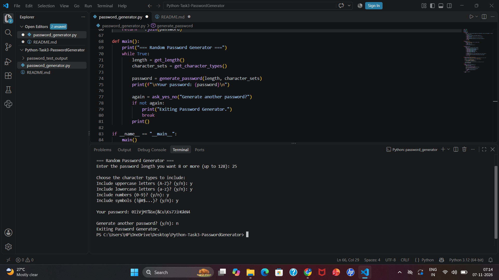
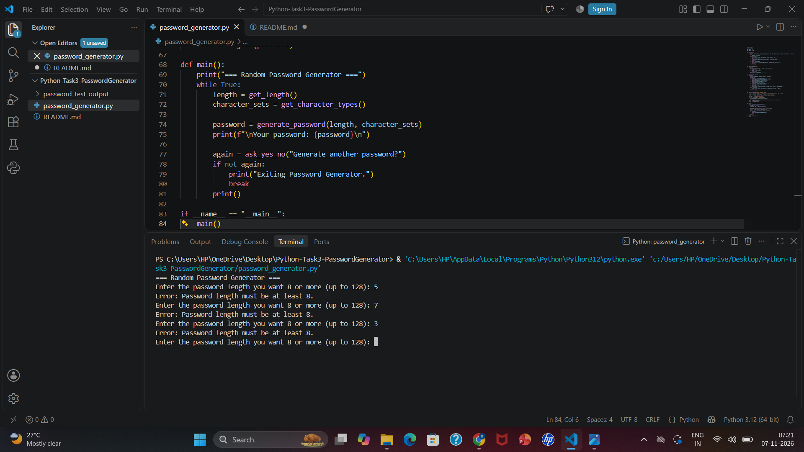

# Random Password Generator (Python - Beginner Tier)

A command-line Python program that generates a strong random password based on the length and character types chosen by the user.

## Features

- Asks for the password length (minimum 8 characters enforced, maximum 128). Pressing Enter uses the default length of 8
- Asks which character types to include: uppercase letters, lowercase letters, numbers and symbols
- At least 2 character types must be selected
- The generated password always contains at least one character from every selected type
- Input validation: rejects text, decimals, lengths below 8 and no character types selected
- Option to generate another password without restarting the program

## How to Run

1. Install Python 3
2. Open a terminal in this folder
3. Run the command: `python password_generator.py`

## How It Works

1. `get_length()` asks for the length. Enter alone uses the default 8. Invalid values (text, decimals, below 8, above 128) are rejected.
2. `get_character_types()` asks yes/no for each character type. If fewer than 2 types are selected, an error is shown and the user is asked again.
3. `generate_password()` picks one character from each selected type, fills the remaining length with random characters from all selected types, and shuffles the result.
4. The password is displayed.
5. The user can generate another password or exit.

## Sample Output

    === Random Password Generator ===
    Enter the password length you want (8 or more, up to 128): 12

    Choose the character types to include:
    Include uppercase letters (A-Z)? (y/n): y
    Include lowercase letters (a-z)? (y/n): y
    Include numbers (0-9)? (y/n): y
    Include symbols (!@#$...)? (y/n): y

    Your password: )1F/@:fMb7Qz

    Generate another password? (y/n): n
    Exiting Password Generator.

## Test Cases

| Input | Expected Result |
|---|---|
| Length 12, all 4 types | 12 character password with every type |
| Length 8 (minimum), uppercase + numbers | 8 character password |
| Length 128 (maximum) | 128 character password |
| Length 5 or 7 | Error: length must be at least 8, asks again |
| Length -4 or 0 | Error, asks again |
| Length `abc` or `8.5` | Error: enter a whole number, asks again |
| Length empty (just press Enter) | Uses default length 8 |
| Length 500 | Error: must not be more than 128 |
| No character type selected | Error, asks types again |
| Only 1 character type selected | Error: select at least 2 types, asks again |
| Answer `maybe` to a y/n question | Error: enter y or n, asks again |
| `y` to "Generate another password?" | Generates a new password |
| `n` to "Generate another password?" | Exits the program |

All test cases listed above were tested and work correctly. Screenshots are shown below.

## Screenshots

Screenshots of the program running are in the `password_test_output` folder.

### Valid password generation

### Invalid input (error handling)

## Author

Bharathula Rama Madhuri

Oasis Infobyte Internship - Python Programming (Task 3)