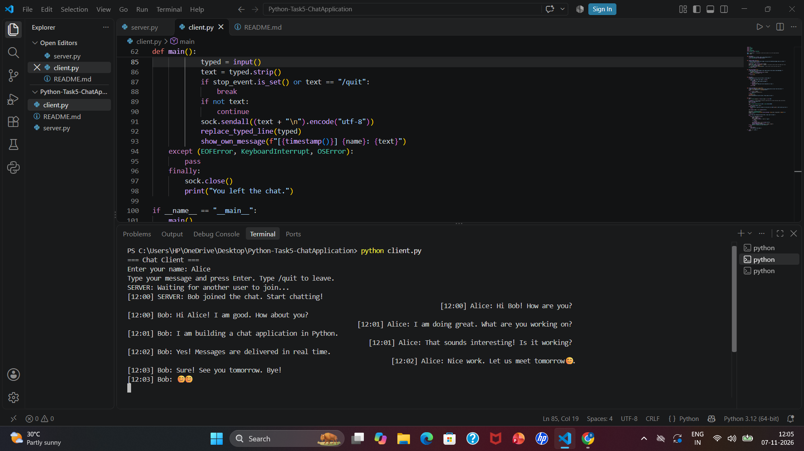
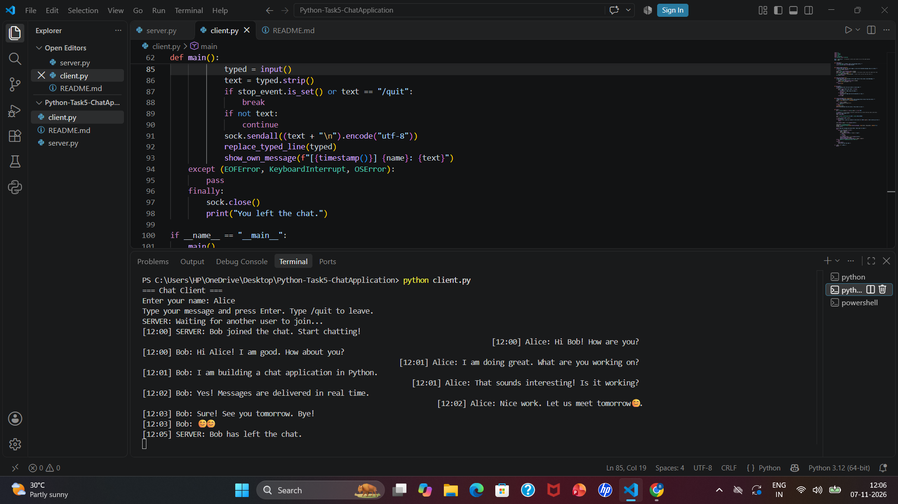

# Chat Application (Python - Beginner Tier)

A command-line, two-user chat application built with Python sockets and threading. One server runs on localhost and two clients connect to it to exchange messages in real time.

## Features

- Server script that listens for incoming client connections
- Client script that connects to the server
- Real-time, two-way message exchange between two connected clients
- Every message has a timestamp prefix, for example `[14:35] Alice: Hello`
- Disconnection handling: when one user leaves, the other user is notified
- Both scripts run on the same machine using localhost (127.0.0.1)
- Chat layout like a messaging app: your own messages appear on the right, the other user's messages on the left
- Extra: name validation, "chat is full" message for a third user, friendly error if the server is not running

## Files

- `server.py` - the chat server
- `client.py` - the chat client (run it twice, once for each user)

## How to Run

You need 3 terminals, all opened in this folder.

1. **Terminal 1 (server):** `python server.py`
2. **Terminal 2 (first user):** `python client.py` and enter a name, for example Alice
3. **Terminal 3 (second user):** `python client.py` and enter a name, for example Bob
4. Type a message in either client and press Enter. The other client receives it instantly.
5. Type `/quit` to leave the chat. The other user is told that you left.

Optional: use another port with `python server.py 6000` and `python client.py 6000`.

## How It Works

1. `server.py` creates a TCP socket, binds it to 127.0.0.1:5000 and waits for clients.
2. For every client that connects, the server starts a new thread (`handle_client`), so both users can chat at the same time.
3. The first line a client sends is its name. The server allows only 2 users; a third user is told the chat is full.
4. When a user sends a message, the server adds a timestamp and the sender name and forwards it to the other user.
5. `client.py` uses one thread to receive messages from the server and the main thread to read what the user types.
6. When a user types `/quit` or closes the window, the server removes that user and notifies the other user.

## Sample Output

Server terminal:

    === Chat Server ===
    Server is listening on 127.0.0.1:5000
    Waiting for clients to connect... (press Ctrl + C to stop)
    [14:35] Alice connected from 127.0.0.1:52341
    [14:35] Bob connected from 127.0.0.1:52342

Alice's terminal:

    === Chat Client ===
    Enter your name: Alice
    Type your message and press Enter. Type /quit to leave.
    SERVER: Waiting for another user to join...
    [14:35] SERVER: Bob joined the chat. Start chatting!
                                              [14:36] Alice: Hello Bob
    [14:36] Bob: Hi Alice
                                   [14:36] Alice: What are you doing??
    [14:37] Bob: I am practising python
    [14:38] SERVER: Bob has left the chat.

Bob's terminal:

    === Chat Client ===
    Enter your name: Bob
    Type your message and press Enter. Type /quit to leave.
    [14:35] SERVER: You are now connected with Alice. Start chatting!
    [14:36] Alice: Hello Bob
                                                 [14:36] Bob: Hi Alice
    [14:36] Alice: What are you doing??
                                   [14:37] Bob: I am practising python
    You left the chat.

## Test Cases

| Test | Expected Result |
|---|---|
| Start the server | Server listens on localhost:5000 |
| First client connects | "Waiting for another user to join..." |
| Second client connects | Both users are told they are connected |
| Alice sends a message | Bob receives `[HH:MM] Alice: message` |
| Bob replies | Alice receives `[HH:MM] Bob: reply` |
| Several messages in a row | They arrive in the same order |
| One user types `/quit` | The other user sees "has left the chat" |
| One user closes the window suddenly | The other user sees "has left the chat" |
| Third client tries to join | "The chat is full" message |
| A user leaves, then a new user joins | The new user can join |
| Empty name or name above 20 characters | Error message, asks again |
| Message sent while alone | "No one else is connected yet" |
| Client started without the server | "Could not connect to the server. Start server.py first." |
| Long message and special characters | Delivered correctly |
| Both users leave | Server keeps running |
| Server is stopped | Client shows "Disconnected from the server" |

## Screenshots

Screenshots of the running application are in the `chat_test_output` folder.

### Chat between two users (Alice's terminal)
Alice's messages appear on the right and Bob's messages on the left, each with a timestamp.

### Disconnection handling
When Bob leaves with `/quit`, Alice is notified: `SERVER: Bob has left the chat.`

## Author

Bharathula Rama Madhuri

Oasis Infobyte Internship - Python Programming (Task 5)